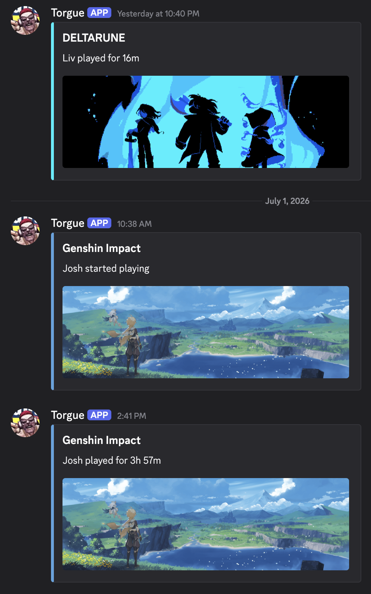

# Notifications & Reporting
Manage where your gaming alerts and weekly reports are sent.

The integration features a powerful, built-in notification engine. You can automatically broadcast when specific players start or finish gaming sessions directly to Discord, via SMS, or straight to your Home Assistant Companion App, without needing external tools like Node-RED or complex YAML automations.

The engine uses native Home Assistant memory to prevent duplicate alerts during rapid game-switching and gives the backend time to fetch high-resolution hero art before broadcasting.

**Example Discord Notifications**


## Options

* **Enable Notifications & Reporting:** Turns session alerts and weekly summaries on or off. Your notification methods and settings are kept while it's off. To flip it without opening another screen, leave the menu dropdown on **Save and return to main menu** and submit.
* **Notification Artwork:** Choose which fetched artwork type (Cover, Hero, Logo, Icon, or No Artwork) attaches to your notifications. Default: Cover.
* **Add Notification:** Map a friendly name (e.g., "Dad's Phone") to an existing Home Assistant `notify.` service, or to a Discord webhook. It fully supports standard mobile app notifications, Discord (through a bot or a webhook), and SMS.
* **Discord Notification Colors:** Customize the embed colors for Discord Bot and Discord Webhook alerts (Default, Platform Colors, Game Color, or Custom Hex). Custom Hex has a separate color per event: started playing (default `#00FF00`), finished playing (`#FF0000`), parental alerts (`#0000FF`), the Rich weekly report (`#F1C40F`), and achievement/trophy unlocks (`#9B59B6`). Achievement/trophy notifications use purple (`#9B59B6`) in Default mode, and follow the game or platform color in the Game Color and Platform Colors modes.
* **Weekly Report:** Send a summary of everyone's weekly playtime to your selected notification methods on a specific day and time (off by default; default time 09:00). Toggle **Enabled**, pick the **Day** and **Time**, and choose the destinations.
    * **Report Style:** **Simple** (a plain, unranked line per player — the original format, unchanged) or **Rich** (players ranked by hours with their top game(s) for the week, a real Discord embed with artwork for Discord Bot and Discord Webhook destinations, and a sorted plain-text version for Mobile App/SMS destinations).
    * **Players to Include:** *(Rich style only)* Leave blank to include every tracked player, or pick specific players to limit the report to just them.
    * **Include players with zero hours:** *(Rich style only)* Off by default, matching the original behavior — players with no logged hours last week are left off the report.
    * **Include artwork:** *(Rich style only)* On by default — attaches the top-ranked player's top game artwork to Discord embeds.
    * **Show each player's top game(s):** *(Rich style only)* On by default. Each player's line becomes a header (e.g. `1. Josh (45h 36m)`) followed by one indented line per game, e.g.:
        ```
        1. Josh (45h 36m)
           - Far Far West (22h 3m)
           - Genshin Impact (16h 18m)
           - ULTRAKILL (14h 24m)
        ```
    * **Number of Top Games to Show:** *(Rich style only, shown when the option above is on)* How many of each player's top games to list, 1-5 (default: 1).
    * **Show rank numbers / Show total summary line:** *(Rich style only)* Both on by default, matching the original Rich format — turn either off to trim the report down.

## Prerequisites
This feature leverages Home Assistant's native notification engine. **It does not create the connection to Discord or your SMS provider for you.** Before configuring this feature, you must already have your desired notification service set up and working in Home Assistant. The only exception is the **Discord Webhook** type, which posts to Discord directly.

* **For Discord Bot:** You must install and configure the official [Discord Integration](https://www.home-assistant.io/integrations/discord/).
* **For Discord Webhook:** Nothing to install. You only need permission to create a webhook in the Discord channel (see [Discord Webhook Settings](#discord-webhook-settings)).
* **For SMS:** You must install an SMS integration (such as [Twilio](https://www.home-assistant.io/integrations/twilio/) or [ClickSend](https://www.home-assistant.io/integrations/clicksend/)).
* **For Mobile:** You must have the Home Assistant Companion App installed on your iOS or Android device.

Once your service is working and you can successfully call it from the Home Assistant Developer Tools, you can plug that exact service name into the Gaming Status integration!

## How to Configure Notifications

With Gaming Status, you can set up global notification destinations (like a specific phone or Discord channel) and assign them to individual players. 

**Step 1: Create a Notification**

1. In Home Assistant, navigate to **Settings** > **Devices & Services**.
2. Click the **Configure** button on the Gaming Status card.
3. Select **Notifications** from the main menu and click Submit.
4. Select **➕ Add New Notification** and click Submit. 
5. Fill out the notification settings (see [Destination Settings](#destination-settings)) and submit to save. You can add as many methods as you need.

**Step 2: Assign to a Player**

1. From the main Gaming Status configuration menu, select **Manage Players**.
2. Select the player you want to edit and proceed to their **Player Details** screen.
3. Under **Session Start Notifications** and **Session End Notifications**, simply select the endpoints you created from the dropdown lists.
   * **Achievement/Trophy Notification(s)** appears below those two once **Enable Achievement/Trophy Tracking** is on (under [Achievements & Ratings](achievements-ratings.md)). Each unlock sends its own notification with the achievement's icon (or the game's artwork if no icon is available), worded like *"Player1 unlocked an achievement in Grand Theft Auto V (Steam)"* (*"a trophy"* on PlayStation), followed by the achievement's name and description, e.g. *"Catch-A-Ride - Collect 10 personal vehicles."*
   * Unlocks arrive when Gaming Status next checks for them (every **Achievement/Trophy Recheck Interval**, 15 minutes by default), not the instant they happen. Only unlocks from the last hour notify, so turning tracking on or a library scan filling in older history won't flood you.
4. Click Submit. *(Home Assistant will automatically reload the integration in the background to apply your new routes!)*

## Destination Settings

* **Name:** A friendly identifier for this notification method (e.g., "Player1's iPhone" or "Family Discord").
* **Notification Type:**
    * `Discord Bot`: Sends a rich embed message complete with the game's title, session duration, and the selected artwork, through the official Discord integration's bot.
    * `Discord Webhook`: Sends the same embed straight to one Discord channel through a webhook, with no bot or Discord integration needed. When you add one, a second screen asks for the webhook's details after you submit. When you edit one, its details are on the same screen, and Notification Type, Notifier and Target ID aren't shown. A webhook can't be changed to another type, and another type can't be changed to a webhook. Delete it and add a new notification instead. See [Discord Webhook Settings](#discord-webhook-settings).
    * `Mobile App`: Sends a Rich Notification directly to your iOS/Android Home Assistant app, featuring the game's art directly on your lock screen!
    * `SMS`: Sends a clean, text-only alert suitable for standard mobile text messages.
* **Notifier:** A dynamic dropdown containing all available Home Assistant notify services (e.g., `notify.mobile_app_player1s_iphone`, `notify.discord_bot`, or `notify.twilio`). Not used for Discord Webhook.
* **Target ID:** The routing ID for the message. 
    * *For Discord Bot:* Paste a Server Channel ID to post publicly to a group, or a specific User ID to send a private Direct Message.
    * *For SMS:* Paste the target phone number.
    * *For Mobile App:* Mobile notifications are routed entirely by the Notifier service name, so **you can leave the Target ID box blank**.
    * *For Discord Webhook:* Not used. The webhook decides which channel the message goes to.

## Discord Webhook Settings

A Discord webhook posts to one channel without a bot. It can't send Direct Messages; use **Discord Bot** for those. You need permission to manage webhooks in that channel.

**Create the webhook in Discord**

1. Open the channel's settings (the gear icon next to the channel name).
2. Select **Integrations** > **Webhooks**, then **New Webhook** (or **Create Webhook**).
3. Optionally give it a name and avatar, then click **Copy Webhook URL**.

Keep the URL private: anyone who has it can post to that channel. Gaming Status hides it in diagnostics downloads.

**Webhook settings**

* **Webhook URL:** The URL you copied. Gaming Status checks it with Discord when you submit.
* **Sender name:** *(Optional)* The name the messages appear under. Leave blank to use the name set on the webhook in Discord.
* **Sender avatar URL:** *(Optional)* An `https://` image URL for the messages' avatar. Leave blank to use the webhook's own avatar.
* **Edit messages instead of posting new ones:** *(Off by default)* Each session leaves one message instead of two. The **started playing** message is posted as usual, and when the session ends that same message is edited to show the finished session and how long it lasted.
    * This applies when the webhook is in the player's **Session Start Notifications** and **Session End Notifications** lists. Achievement, parental and weekly report notifications are always new messages.
    * When a player switches games, the previous game's message is edited to show how long it was played, and a new **started playing** message is posted for the new game.
    * A switch within 90 seconds of a session starting (for example, a launcher opening the game) doesn't send a notification, as with every notification type. The **started playing** message then belongs to the new game, and is edited when that game ends.
    * Discord doesn't send a notification for an edited message, so only session starts alert anyone.
    * Editing keeps working after Home Assistant restarts. If the message was deleted in Discord, a new **finished** message is posted instead.
* **Enable edit timestamp:** *(Off by default, only used when editing messages is on)* Adds a time at the bottom of each session message that updates when the message is edited, so a finished session shows what time it ended. Discord shows it in each reader's own time zone. The time next to the sender's name always stays the time the message was first posted, which is when the session started.

**Discord Bot or Discord Webhook?**

* Use **Discord Webhook** for the simplest setup, a custom sender name and avatar, or the option to edit messages.
* Use **Discord Bot** (the official Discord integration) to send private Direct Messages to a user, or to reach several channels from one notification service. A webhook only ever posts to the channel it was created in.
