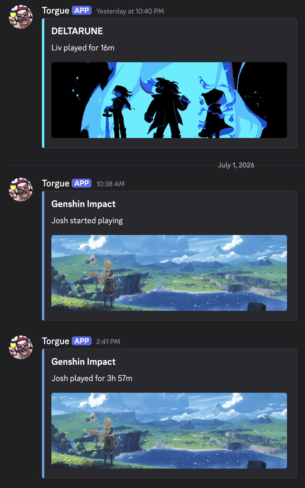

# Notifications & Reporting
Manage where your gaming alerts and weekly reports are sent.

The integration features a powerful, built-in notification engine. You can automatically broadcast when specific players start or finish gaming sessions directly to Discord, via SMS, or straight to your Home Assistant Companion App, without needing external tools like Node-RED or complex YAML automations.

The engine uses native Home Assistant memory to prevent duplicate alerts during rapid game-switching and gives the backend time to fetch high-resolution hero art before broadcasting.

**Example Discord Notifications**


## Options

* **Enable Notifications & Reporting:** Turns session alerts and weekly summaries on or off. Your notification methods and settings are kept while it's off. To flip it without opening another screen, leave the menu dropdown on **Save and return to main menu** and submit.
* **Notification Artwork:** Choose which fetched artwork type (Cover, Hero, Logo, Icon, or No Artwork) attaches to your notifications. Default: Cover.
* **Add Notification:** Map a friendly name (e.g., "Dad's Phone") to an existing Home Assistant `notify.` service. It fully supports standard mobile app notifications, Discord, and SMS.
* **Discord Notification Colors:** Customize the embed colors for Discord alerts (Default, Platform Colors, Game Color, or Custom Hex). Custom Hex has a separate color per event: started playing (default `#00FF00`), finished playing (`#FF0000`), parental alerts (`#0000FF`), and the Rich weekly report (`#F1C40F`).
* **Weekly Report:** Send a summary of everyone's weekly playtime to your selected notification methods on a specific day and time (off by default; default time 09:00). Toggle **Enabled**, pick the **Day** and **Time**, and choose the destinations.
    * **Report Style:** **Simple** (a plain, unranked line per player — the original format, unchanged) or **Rich** (players ranked by hours with their top game(s) for the week, a real Discord embed with artwork for Discord destinations, and a sorted plain-text version for Mobile App/SMS destinations).
    * **Players to Include:** *(Rich style only)* Leave blank to include every tracked player, or pick specific players to limit the report to just them.
    * **Include players with zero hours:** *(Rich style only)* Off by default, matching the original behavior — players with no logged hours last week are left off the report.
    * **Include artwork:** *(Rich style only)* On by default — attaches the top-ranked player's top game artwork to Discord embeds.
    * **Show each player's top game(s):** *(Rich style only)* On by default. Each player's line becomes a header (e.g. `1. Josh (45h 36m)`) followed by one indented line per game, e.g.:
        ```
        1. Josh (45h 36m)
           - Far Far West (22h 3m)
           - Genshin Impact (16h 18m)
           - ULTRAKILL (14h 24m)
        ```
    * **Number of Top Games to Show:** *(Rich style only, shown when the option above is on)* How many of each player's top games to list, 1-5 (default: 1).
    * **Show rank numbers / Show total summary line:** *(Rich style only)* Both on by default, matching the original Rich format — turn either off to trim the report down.

## Prerequisites
This feature leverages Home Assistant's native notification engine. **It does not create the connection to Discord or your SMS provider for you.** Before configuring this feature, you must already have your desired notification service set up and working in Home Assistant. 

* **For Discord:** You must install and configure the official [Discord Integration](https://www.home-assistant.io/integrations/discord/).
* **For SMS:** You must install an SMS integration (such as [Twilio](https://www.home-assistant.io/integrations/twilio/) or [ClickSend](https://www.home-assistant.io/integrations/clicksend/)).
* **For Mobile:** You must have the Home Assistant Companion App installed on your iOS or Android device.

Once your service is working and you can successfully call it from the Home Assistant Developer Tools, you can plug that exact service name into the Gaming Status integration!

## How to Configure Notifications

With Gaming Status, you can set up global notification destinations (like a specific phone or Discord channel) and assign them to individual players. 

**Step 1: Create a Notification**

1. In Home Assistant, navigate to **Settings** > **Devices & Services**.
2. Click the **Configure** button on the Gaming Status card.
3. Select **Notifications** from the main menu and click Submit.
4. Select **➕ Add New Notification** and click Submit. 
5. Fill out the notification settings (see [Destination Settings](#destination-settings)) and submit to save. You can add as many methods as you need.

**Step 2: Assign to a Player**

1. From the main Gaming Status configuration menu, select **Manage Players**.
2. Select the player you want to edit and proceed to their **Player Details** screen.
3. Under **Session Start Notifications** and **Session End Notifications**, simply select the endpoints you created from the dropdown lists.
4. Click Submit. *(Home Assistant will automatically reload the integration in the background to apply your new routes!)*

## Destination Settings

* **Name:** A friendly identifier for this notification method (e.g., "Player1's iPhone" or "Family Discord").
* **Notification Type:** * `Discord`: Sends a rich embed message complete with the game's title, session duration, and the selected artwork.
    * `Mobile App`: Sends a Rich Notification directly to your iOS/Android Home Assistant app, featuring the game's art directly on your lock screen!
    * `SMS`: Sends a clean, text-only alert suitable for standard mobile text messages.
* **Notifier:** A dynamic dropdown containing all available Home Assistant notify services (e.g., `notify.mobile_app_player1s_iphone`, `notify.discord_bot`, or `notify.twilio`).
* **Target ID:** The routing ID for the message. 
    * *For Discord:* Paste a Server Channel ID to post publicly to a group, or a specific User ID to send a private Direct Message.
    * *For SMS:* Paste the target phone number.
    * *For Mobile App:* Mobile notifications are routed entirely by the Notifier service name, so **you can leave the Target ID box blank**.
